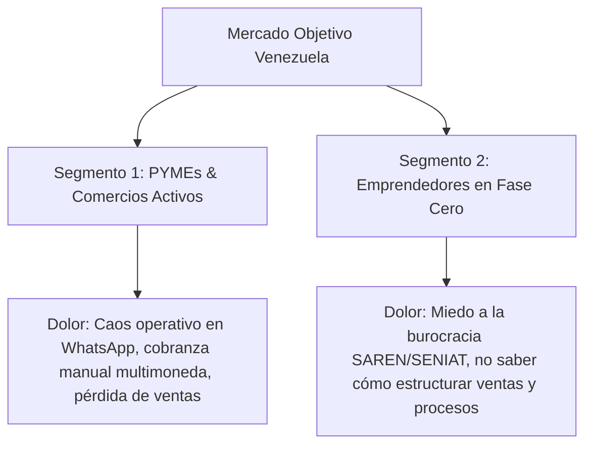
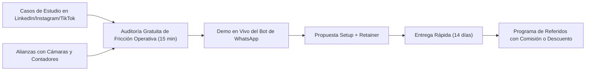

# Startup Canvas: ImpulseTech

> **Acompañamiento Integral en Transformación Digital, Automatización con IA, Desarrollo de Software a la Medida y Formalización Legal-Administrativa para Negocios en Venezuela.**

---

## 1. Visión (Vision)

- **Propósito Inspirador**: Catalizar el renacimiento productivo del tejido empresarial venezolano, permitiendo que cualquier emprendedor o empresa opere con estándares tecnológicos y de eficiencia globales sin que la burocracia o el atraso operativo sean un freno.
- **Aspiración a 3-5 años**: Convertirnos en el socio estratégico #1 de operaciones y tecnología para más de 500 PYMEs en Venezuela y la región andina/caribeña, creando la primera plataforma híbrida (legal-tech + IA operativa) "De la Idea a la Escala".
- **Valores Fundamentales**:
  - **Pragmatismo Radical**: Soluciones que resuelven problemas reales de caja y tiempo hoy, no teoría abstracta.
  - **Transparencia y Compliance**: Cero atajos turbios; blindaje legal y administrativo real frente a los entes reguladores (SENIAT, SAREN, Alcaldías).
  - **Obsesión por el ROI del Cliente**: Cada automatización o trámite debe ahorrar horas hombre o generar ingresos medibles directos.

---

## 2. Segmentos de Mercado (Market Segments)

El mercado no se divide por demografía, sino por el dolor operativo y el **Job to Be Done (JTBD)**.



### Segmento 1 (Early Adopters A - Mayor flujo de caja rápido): PYMEs y Comercios ya operativos
- **Perfil**: Negocios con 3 a 25 empleados (restaurantes, retail, distribuidores, academias, servicios de salud/estética, consultorías).
- **JTBD**: *"Ayúdame a no perder clientes en WhatsApp, a conciliar los pagos multimoneda (Pago Móvil / Zelle / USDT) sin errores humanos y a reducir horas de trabajo repetitivo de mi personal para poder vender más con el mismo equipo."*
- **Restricciones locales**: Personal con alta rotación, conexiones a internet variables, desconfianza hacia software costoso en dólares que luego nadie sabe usar.

### Segmento 2 (Early Adopters B - Máxima sinergia Legal + Tech): Nuevos Emprendedores "Born Digital"
- **Perfil**: Profesionales, importadores o prestadores de servicios que inician un nuevo negocio y quieren hacer las cosas bien desde el día 1.
- **JTBD**: *"Hazme la constitución legal de mi empresa sin dolores de cabeza y entrégame de una vez mis canales de venta, CRM y procesos automatizados para facturar inmediatamente."*
- **Restricciones locales**: Temor a multas del SENIAT o clausuras de alcaldía, falta de orientación sobre cuentas bancarias nacionales e internacionales y registro de marca.

---

## 3. Costos Relativos (Relative Costs)

- **Posicionamiento**: **Diferenciación y Valor Único (Unique Value)** con precios accesibles orientados a PYME (no bajo costo estilo commodity).
- **Justificación**:
  - Competir por precio bajo en trámites legales o automatizaciones atrae clientes tóxicos y erosiona el margen necesario para dar soporte de calidad.
  - El valor único radica en la **fusión**: un gestor tradicional no sabe qué es un webhook ni un LLM; una agencia de marketing o programadores freelance no conocen el Código de Comercio ni las retenciones de ISLR/IVA del SENIAT.
  - La propuesta combinada ahorra al cliente contratar a 3 proveedores distintos (abogado + contador + desarrollador/agencia).

---

## 4. Propuesta de Valor (Value Proposition)

| Dimensión | Segmento 1: PYMEs Operativas (Tech & IA) | Segmento 2: Nuevos Emprendedores (Legal + Tech) |
| :--- | :--- | :--- |
| **Estado Anterior (What Before)** | Clientes esperando horas en WhatsApp; dueños respondiendo mensajes a medianoche; cobros de Pago Móvil revisados a mano; inventario desfasado; pérdida de prospectos. | Negocio operando en la informalidad; miedo al SAREN; incertidumbre fiscal; cuentas personales mezcladas con las del negocio; sin herramientas digitales. |
| **Cómo lo Resolvemos (How)** | Implementación de agentes de IA en WhatsApp Business (vía n8n/Make + LLMs), bots de calificación de leads, conciliación semiautomática de pagos y alertas en Notion/Google Sheets/CRM. | Paquete llave en mano: Redacción y registro de acta constitutiva, RIF jurídico, asesoría bancaria/fiscal + configuración de suite digital de productividad y bot básico de atención. |
| **Estado Posterior (What After)** | Respuestas en < 30 segundos 24/7; aumento de 25-40% en tasa de conversión de leads; liberación de 15+ horas semanales del dueño/gerente; reportes en tiempo real. | Empresa legalmente constituida y protegida; lista para contratar con entes formales o emitir facturas legales; sistema operativo digital listo para operar desde el día 1. |
| **Alternativas y Diferenciación** | Software extranjero inaccesible o caro (HubSpot, Salesforce) o bots rígidos tipo ManyChat que no entienden jerga venezolana ni pagos locales. | Gestores informales que tardan meses y cobran sobreprecios opacos, o bufetes caros que entregan un papel y se desentienden de la operación real. |

### Curva de Valor vs Alternativas Tradicionales

```
Nivel de Atributo (1-5)
Atributo                | Gestor Legal Trad. | Agencia Tech Extranjera | ImpulseTech
-------------------------------------------------------------------------------------
Comprensión de IA/Auto  |        1          |           5             |      5
Adaptación a Venezuela  |        5          |           1             |      5
Solución Fin-a-Fin      |        2          |           2             |      5
Agilidad de Ejecución   |        2          |           3             |      4
Soporte Post-Entrega    |        1          |           2             |      4
```

---

## 5. Renuncias Estratégicas (Trade-offs)

Para tener foco y no diluir los recursos, **ImpulseTech dice NO a**:

1. **NO a proyectos de software sin alcance claro o tecnologías heredadas/obsoletas**: Ofrecemos desarrollo de software a la medida enfocado en web apps modernas, portales de gestión, integraciones y backoffices de alto ROI (stacks ágiles tipo Next.js, Supabase, Node, APIs cloud). Decimos NO a proyectos difusos sin especificación, mantenimiento de sistemas legados de terceros o arquitecturas sobredimensionadas que no aporten tracción rápida.
2. **NO a litigios legales o juicios contenciosos**: Nos enfocamos estrictamente en derecho corporativo preventivo, societario, mercantil y compliance administrativo para negocios. No llevamos causas penales, laborales conflictivas o divorcios.
3. **NO a clientes que busquen evadir ilegalmente o atajos no éticos**: Blindamos el negocio en regla; no nos prestamos para falsificaciones o prácticas que pongan en riesgo la reputación de la firma.
4. **NO a consultoría teórica de "powerpoints"**: Todo entregable debe ser un trámite completado o un flujo tecnológico operativo y testeado con usuarios reales.

---

## 6. Métricas Clave (Key Metrics)

- **North Star Metric (Métrica Estrella Norte)**:
  > **Horas operativas mensuales ahorradas a nuestros clientes + Empresas formalizadas y operativas activas.**
  *(Refleja directamente el valor generado tanto en la vertiente tecnológica como en la legal).*

- **One Metric That Matters (OMTM - Trimestre 1)**:
  > **Tasa de Cierre y Activación de los primeros 10 clientes piloto integrados** (con Setup completo y al menos 1 flujo en producción con NPS > 8/10).

- **Métricas Secundarias de Salud del Negocio**:
  - **Monthly Recurring Revenue (MRR)** derivado de contratos de mantenimiento y soporte IA.
  - **Tiempo promedio de entrega (TAT)**: Días desde la firma del contrato hasta el bot/flujo en producción (< 14 días).
  - **LTV / CAC Ratio**: Mantener el costo de adquisición bajo apalancando referidos y contenido educativo de alto valor.

---

## 7. Estrategia de Crecimiento (Growth)

Modelo híbrido: **Sales-Led con Apalancamiento en Contenido de Autoridad (Content-Driven Sales)**.



### Canales Principales en Venezuela:
1. **Instagram y LinkedIn**: Contenido práctico de desmontaje: *"Mira cómo este restaurante en Caracas automatizó la confirmación de pago móvil en 5 segundos con IA"* o *"Los 3 errores en tu acta constitutiva que el SENIAT no te perdona"*.
2. **Alianzas Estratégicas con Contadores Públicos**: Los contadores en Venezuela sufren recopilando facturas y comprobantes. Si automatizamos su proceso y les pagamos comisión por referir clientes para constitución o automatización, se vuelven nuestro principal canal B2B.
3. **Eventos y Networking en Cámaras de Comercio**: Talleres prácticos presenciales o webinars ("IA para dueños de negocios sin conocimientos técnicos").

---

## 8. Capacidades y Recursos Requeridos (Capabilities)

| Capacidad | ¿Construir Internamente o Aliar? | Descripción / Acción |
| :--- | :--- | :--- |
| **Arquitectura de Automatizaciones e IA** | **Interno (Core)** | Dominio de orquestadores (n8n self-hosted para abaratar costes de servidores, Make, Python scripts), WhatsApp Cloud API y prompts avanzados de LLMs. |
| **Gestoría Legal y Trámites SAREN** | **Híbrido (Interno + Aliados de Campo)** | Redacción de actas y estrategia corporativa interna; tramitadores/abogados colegiados de confianza en los registros mercantiles locales para agilizar sellos y firmas. |
| **Infraestructura de Hosting Económica** | **Interno** | Despliegue de instancias VPS (Hetzner / DigitalOcean / Railway) para correr instancias de n8n y bases de datos con costos fijos mínimos. |
| **Diseño y UX de Interfaces Ligeras** | **Aliado / Freelance** | Creación de dashboards sencillos para clientes si requieren reportes visuales personalizados. |

---

## 9. Prueba de Inmunidad Competitiva (Can't / Won't Test)

¿Por qué los competidores no pueden o no querrán copiarnos fácilmente?

- **Los Bufetes de Abogados tradicionales NO QUERRÁN (Won't)**:
  - Tienen una cultura rígida y tradicional; cobran por hora o documento; ven la tecnología como un costo ajeno a su especialidad y carecen de personal técnico para programar APIs o configurar servidores.
- **Las Agencias de Marketing o Devs Freelance NO PODRÁN (Can't)**:
  - No entienden el marco regulatorio mercantil venezolano (leyes laborales, registros de comercio, régimen de retenciones, normativa de facturación). No tienen la credibilidad jurídica ante el dueño del negocio.
- **El Efecto Red y Coherencia del Sistema**:
  - Al acompañar al emprendedor desde que nace en el registro mercantil, conocemos íntimamente sus números, sus socios y sus procesos. Esto nos da un **lock-in natural positivo**: cuando necesita automatizar, somos la única opción lógica y de máxima confianza.

---

## 10. Estructura de Costos (Cost Structure)

### Costos Fijos Iniciales (Mensuales - Estimados para arrancar magro):
- **Infraestructura Cloud / Servidores**: ~$30 - $60 / mes (VPS Hetzner/DigitalOcean para n8n self-hosted, proxies y bases de datos).
- **Consumo de APIs de IA**: ~$20 - $80 / mes (OpenAI / Anthropic / Gemini según volumen de tokens de pruebas y soporte).
- **Herramientas de Trabajo**: ~$50 / mes (Dominios, workspace, software de gestión de tareas, VPNs).
- **Gastos Operativos Locales**: Transporte para trámites presenciales, papelería y timbres fiscales.

### Costos Variables (Escalan con cada cliente):
- **Aranceles del SAREN y tasas del Registro Mercantil**: Se cobran directamente al cliente o como parte del paquete prepagado.
- **Honorarios de visado y gestoría de campo**: Pago por trámite concluido al abogado/gestor aliado.
- **Costo de WhatsApp Business API**: Meta cobra por conversación de servicio/marketing; este costo se traslada al cliente o se integra en su fee mensual.

---

## 11. Fuentes de Ingresos (Revenue Streams)

Modelo dual flexible adaptado al tipo de cliente:

```
                          ┌───> Paquete 1: Constitución Legal + Setup Digital ("Llave en Mano")
                          │     Ticket: $400 - $800 USD (Pago único)
                          │
                          ├───> Paquete 2: Automatización e IA Operativa (PYMEs Activas)
                          │     Ticket: $350 - $1,200 USD Setup (según complejidad)
                          │
MODELO DE INGRESOS ───────┼───> Paquete 3: Desarrollo de Software a la Medida (Web Apps, Portales, Backoffices)
                          │     Ticket: $800 - $3,500+ USD por proyecto / hito
                          │
                          └───> Paquete 4: Retainer Mensual de Soporte, Mantenimiento & Cloud
                                Ticket: $80 - $350 USD / mes (Ingreso Recurrente)
```

1. **Setup Inicial Llave en Mano**:
   - *Pack "Nace Digital"*: Constitución de empresa (redacción, registro, RIF) + Setup de Google Workspace / Notion + Bot inicial de WhatsApp para atención y catálogo.
   - *Pack "Automatización PYME"*: Auditoría de procesos + Diseño del flujo en n8n + Integración con WhatsApp + Capacitación del equipo.
2. **Desarrollo de Software a la Medida**:
   - *Desarrollo Web & Apps Internas*: Aplicaciones web full-stack, dashboards operativos, sistemas de gestión interna (CRMs, cotizadores, portales de clientes) con arquitectura moderna (Next.js, Supabase, APIs).
3. **Retainer Mensual de Operaciones, IA & Software (Suscripción)**:
   - Monitoreo continuo de bots y APIs, mantenimiento evolutivo de software, actualización de prompts, soporte a usuarios y hosting gestionado.
4. **Servicios Complementarios (Upsell)**:
   - Modificaciones de actas de asamblea, venta de acciones, registro de marcas (SAPI), auditoría de compliance preventivo.

---

## 12. Validación de Coherencia e Hipótesis Críticas

Para que este modelo triunfe en Venezuela, las siguientes hipótesis deben ser validadas:

1. **Hipótesis de Demanda**: Los dueños de negocios venezolanos están dispuestos a pagar un retainer recurrente en dólares por el mantenimiento y optimización de sus automatizaciones, en lugar de solo querer un arreglo puntual.
2. **Hipótesis de Integración Legal-Tech**: El cliente percibe un valor significativamente mayor al contratar la constitución + tecnología juntas frente a buscar un abogado tradicional por un lado y un informático por el otro.
3. **Hipótesis Operativa**: La infraestructura tecnológica (n8n + WhatsApp API) puede operar con estabilidad suficiente en Venezuela mediante servidores en la nube sin depender de la conectividad local del cliente.

---

## 13. Experimentos de Bajo Esfuerzo para Validar Ya (Próximos 14 días)

- [ ] **Experimento 1: El "Diagnóstico Gratuito de WhatsApp y Fricción Operativa"**
  - *Acción*: Seleccionar 15 negocios locales activos (tiendas de Instagram, clínicas dentales, distribuidores de repuestos o ferreterías en tu ciudad). Enviar mensajes de prueba a sus números de WhatsApp evaluando tiempos de respuesta y fricción al cotizar.
  - *Medición*: Contactar al dueño ofreciendo un reporte de 2 páginas con las fallas encontradas y una demo funcional de 2 minutos de cómo un bot con IA respondería y agendaría sus citas o pedidos.
  - *Criterio de éxito*: Al menos 3 dueños aceptan una reunión para cotizar la implementación.

- [ ] **Experimento 2: Landing / Carnet de Servicios "Nace Digital"**
  - *Acción*: Crear un flyer o landing page de 1 página presentando el paquete integral: "Constituye tu empresa en Venezuela y déjala facturando con IA en 15 días".
  - *Medición*: Presentarlo a 10 emprendedores que aún no están formalizados o que operan con cuentas personales.
  - *Criterio de éxito*: Al menos 2 prospectos solicitan presupuesto formal de registro y setup.

---

## 14. Arquitectura del Sistema y Stack Tecnológico (CRM ImpulseTech)

La aplicación web interna de ImpulseTech es el sistema operativo central que orquesta leads, clientes, servicios multimodales (legal, IA, software) y cobranzas.

```
                          ┌────────────────────────┐
                          │   Angular 18+ (SPA)    │
                          │   (impulsetech-fe)     │
                          └───────────┬────────────┘
                                      │ REST / JSON (JWT Auth)
                                      ▼
                          ┌────────────────────────┐
                          │   FastAPI (Python)     │
                          │   (impulsetech-be)     │
                          └───────────┬────────────┘
                                      │ SQLAlchemy Async / asyncpg
                                      ▼
                          ┌────────────────────────┐
                          │   PostgreSQL 16        │
                          │   (dbmate migrations)  │
                          └────────────────────────┘
```

### Definición del Stack:
- **Frontend (`impulsetech-fe`)**:
  - Framework: Angular 18+ con arquitectura Standalone Components y Signals.
  - Estilos y UI: Tailwind CSS / SCSS bajo la directiva estricta de la skill `frontend-design`.
  - Seguridad UI: HTTP Interceptor para inyección de token JWT, Guards funcionales (`canActivate`).
  - Separación de plantillas: Estrictamente prohibido el uso de `template` inline en componentes; plantillas siempre en archivos `.component.html` independientes.
- **Backend (`impulsetech-be`)**:
  - Framework: Python 3.12+ / FastAPI.
  - ORM & BD: SQLAlchemy 2.0 (Async) + asyncpg / Pydantic v2 para esquemas y validación estricta de DTOs.
  - Autenticación: JWT (JSON Web Tokens) con hash seguro de contraseñas (Passlib / bcrypt).
  - Estructura modular: `core/` (config, security, db), `modules/` (`auth`, `users`, `leads`, `clients`, `services`, `payments`), `schemas/`, `models/`.
- **Base de Datos y Migraciones (`impulsetech-migration`)**:
  - Motor: PostgreSQL 16.
  - Gestor de Migraciones: `dbmate` con scripts SQL DDL puros versionados (`db/migrations/YYYYMMDDHHMMSS_*.sql`).
  - Regla de Oro: Prohibida la ejecución de migraciones en entornos productivos sin validación previa en el entorno local.
- **Orquestador y Entorno Local (`impulsetech`)**:
  - Docker Compose: Levanta localmente los servicios `postgres`, `migration` (dbmate up), `backend` (FastAPI con reload) y `frontend` (Angular dev server).
  - Repositorio raíz que aloja agentes, planes (`plans/`), planes de prueba (`test/`) y este documento de contexto (`STARTUP_CANVAS.md`).

---

## 15. Modelo de Datos Canónico y Reglas de Negocio

### Entidades Centrales y Relaciones:

1. **`usuarios` (Ejecutivos y Admins)**:
   - Campos: `id` (UUID), `nombre`, `email` (unique), `password_hash`, `rol` (`ADMIN` | `EJECUTIVO`), `activo` (bool), `created_at`, `updated_at`.
   - Regla: En la Fase 1 solo existen usuarios Admin (dueño) y Ejecutivos de Cuenta.

2. **`clientes` (Empresas o Personas Jurídicas/Naturales)**:
   - Campos: `id` (UUID), `razon_social`, `rif_identificacion`, `contacto_principal`, `telefono_whatsapp`, `email`, `direccion_ciudad`, `ejecutivo_id` (FK `usuarios.id`), `estado` (`ACTIVO` | `INACTIVO` | `MOROSO`), `notas`, `created_at`, `updated_at`.
   - Regla de Negocio: **Un cliente tiene un único Ejecutivo Responsable asignado** (quien lidera la relación comercial y seguimiento).

3. **`leads` (Oportunidades de Venta y Embudos)**:
   - Campos: `id` (UUID), `nombre_contacto`, `empresa_o_proyecto`, `telefono_whatsapp`, `email`, `embudo` (`LEGAL_SAREN` | `IA_AUTOMATIZACION` | `SOFTWARE_MEDIDA`), `etapa` (`NUEVO` | `DIAGNOSTICO` | `PROPUESTA` | `NEGOCIACION` | `GANADO` | `PERDIDO`), `motivo_perdida` (opcional), `valor_estimado_usd` (decimal), `ejecutivo_asignado_id` (FK `usuarios.id`), `cliente_id` (FK `clientes.id`, nullable si no ha ganado), `created_at`, `updated_at`.
   - Regla de Negocio: **3 Embudos separados**. Al pasar a etapa `GANADO`, el sistema convierte automáticamente el lead en un `cliente` y abre su primer `servicio`.

4. **`servicios` (Contratos Operativos por Cliente)**:
   - Campos: `id` (UUID), `cliente_id` (FK `clientes.id`), `tipo` (`LEGAL_SAREN` | `IA_AUTOMATIZACION` | `SOFTWARE_MEDIDA` | `RETAINER_MENSUAL`), `nombre_servicio` (varchar), `modalidad` (`PROYECTO_UNICO` | `RECURRENTE_MENSUAL`), `estado_operativo` (`EN_ESPERA` | `EN_DESARROLLO` | `EN_REVISION` | `ACTIVO_PRODUCCION` | `FINALIZADO` | `PAUSADO`), `especialista_responsable` (varchar/texto libre para gestor de campo o dev asignado), `monto_pactado_usd` (decimal), `fecha_inicio` (date), `fecha_entrega_estimada` (date, nullable), `dia_corte_mensual` (int 1-31, nullable para retainers), `created_at`, `updated_at`.
   - Regla de Negocio: **Un cliente puede tener múltiples servicios activos en paralelo**. Cada servicio tiene su propio estado, especialista asignado y cronograma independiente.

5. **`pagos` (Control Financiero y Cobranzas)**:
   - Campos: `id` (UUID), `cliente_id` (FK `clientes.id`), `servicio_id` (FK `servicios.id`, opcional para abonos generales), `monto` (decimal), `moneda` (`USD` | `VES` | `USDT`), `tasa_cambio_bcv` (decimal, si moneda es VES), `medio_pago` (`ZELLE` | `PAGO_MOVIL` | `USDT_BINANCE` | `EFECTIVO_USD` | `TRANSFERENCIA_VES`), `referencia_bancaria` (varchar), `concepto` (`ANTICIPO_50` | `FINIQUITO` | `CUOTA_RETAINER` | `OTRO`), `estado_pago` (`PENDIENTE` | `VERIFICADO` | `RECHAZADO`), `fecha_pago` (date), `comprobante_url` (varchar opcional), `created_at`, `updated_at`.
   - Regla de Negocio: Gestión multimoneda para la realidad venezolana; alertas de vencimiento para retainers y verificación de anticipos antes de iniciar proyectos.

---

## 16. Protocolo de Desarrollo y Gobernanza de Agentes

El desarrollo de ImpulseTech opera bajo un flujo agentico automatizado basado en Trello, GitHub y Docker:

### Tablero de Trello: `https://trello.com/b/VNgiLVB1/impulsetech`
Columnas del flujo:
1. **`to refine`**: Requerimientos crudos o ideas pendientes de detalle técnico.
2. **`To Do`**: Tarjetas completamente refinadas con especificación técnica, DDL, backend, frontend y criterios DoD (`[IT-XX]`), listas para ser tomadas.
3. **`in development`**: Tarjeta en proceso de planificación/implementación activa por los agentes.
4. **`in testing`**: Tarea con código completado, compilación limpia, tests aprobados y documento de prueba generado en `test/`.
5. **`Done`**: Aprobado por el Product Owner / Admin y fusionado a la rama principal.

### Roles de los Agentes:
1. **`trello_refiner`**:
   - Analiza requerimientos en `to refine`.
   - Consulta esta biblia (`STARTUP_CANVAS.md`).
   - Resuelve dudas con el usuario antes de asumir cualquier regla.
   - Redacta la tarjeta formal `[IT-XX]` con especificación de BD, Backend y Frontend, y la mueve a `To Do`.
2. **`trello_planner`**:
   - Toma tarjetas de `in development`.
   - Escribe el plan de implementación exhaustivo en `plans/IT-XX-plan-<slug>.md`.
   - Define el DDL exacto, endpoints FastAPI, contratos TypeScript y checklist detallado.
3. **`trello_implementer`**:
   - Lee el plan aprobado en `plans/`.
   - Escribe el código en `impulsetech-be`, `impulsetech-fe` y `impulsetech-migration`.
   - Aplica obligatoriamente la skill `frontend-design` para Angular (evitando plantillas genéricas de IA y construyendo una identidad visual sobria y profesional de consultoría tecnológica/legal).
   - Valida compilación y tests locales.
   - Genera el documento de prueba obligatorio en `test/IT-XX-test-plan-<slug>.md`.
   - Crea ramas `feature/IT-XX-*`, commits y Pull Requests con `gh pr create`.
   - Mueve la tarjeta a `in testing` en Trello con el resumen del PR y tests.

---

## 17. Roadmap de Fases de Construcción del MVP

- **Fase 1: Infraestructura Base y Autenticación (Fundaciones)**
  - Repositorios en GitHub (`impulsetech`, `impulsetech-be`, `impulsetech-fe`, `impulsetech-migration`).
  - Orquestación con `docker-compose.yml` (PostgreSQL, dbmate, FastAPI, Angular).
  - Migración inicial DDL con dbmate (tablas `usuarios`).
  - Auth JWT en FastAPI (login, refresh, me) y Guards/Interceptors en Angular 18.
  - Layout base de la aplicación (Sidebar responsivo, Navbar de usuario, temas con tokens de diseño).

- **Fase 2: Gestión de Ejecutivos y Ficha 360° del Cliente**
  - DDL de tabla `clientes`.
  - API REST en FastAPI para CRUD y asignación de clientes a ejecutivos.
  - Vistas Angular: Directorio de clientes con filtros rápidos, búsqueda y modal/página de ficha 360°.

- **Fase 3: Pipelines de Leads y Embudos Especializados**
  - DDL de tabla `leads`.
  - API REST con filtros por tipo de embudo (`LEGAL_SAREN`, `IA_AUTOMATIZACION`, `SOFTWARE_MEDIDA`).
  - Vistas Angular: Tableros Kanban drag-and-drop / columnas por etapas.
  - Acción de conversión: Lead Ganado -> Creación inmediata de Cliente + Apertura de Servicio.

- **Fase 4: Módulo de Servicios Operativos por Cliente**
  - DDL de tabla `servicios`.
  - API REST para gestionar estados de entrega, modalidades (único vs mensual) y especialista a cargo.
  - Vistas Angular: Matriz de seguimiento operativo y pestaña de servicios en la ficha del cliente.

- **Fase 5: Módulo Financiero Multimoneda y Cobranzas**
  - DDL de tabla `pagos`.
  - API REST para registrar transacciones multimoneda (USD, VES con tasa, USDT) y consultar balances por cliente.
  - Vistas Angular: Caja chica / Historial de pagos, semáforo de cobranza (al día, pendiente, moroso) y alertas de retainers.
